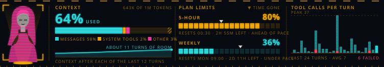

# Interlinked

A retro-future noir theme for the Claude desktop app's Code tab. It is a Claude Code **mod**: a plugin that restyles the app from the inside.



## What you get

- **The app's own colors.** Blue-black surfaces, warm paper-white type and cyan controls, with code highlighted in the same neon set.
- **A moving city behind the conversation.** Megastructure towers, flare stacks, an airship, flying craft, sweeping searchlights and rain, seen through frosted panels.
- **A command console above the prompt.** Every mark on it is a real reading from your session:
  - **Context:** percent used, what is filling the window, and a trend with an estimate of the turns you have left.
  - **Plan limits:** how much of each limit is used against how much of its time has gone, and when it resets.
  - **Tool calls per turn:** one bar per recent turn, with failed calls in red.
  - A live row of counters, session uptime and a clock.
- **A hologram companion, Joi.** She stands in the console and says one useful line at a time: context nearly full, a limit running out, a tool call that failed.
- **A restyled conversation.** Tags on your messages and Claude's, numbered cards on tool calls, and a stamp under each answer with its time and usage.
- **A control deck.** A side panel with a button for every option.



Three looks ship with it: **Neon Noir** (the default), **Amber Dust** and **Acid Rain**.

## Requirements

- The Claude desktop app, with a local session in the Code tab.
- Claude Code **2.1.325 or later** inside the app. Type `/status` in a session to check, and update the desktop app if yours is older.

The terminal and editor extensions draw no look, so the theme does nothing visible there. It was built and checked on Windows with Claude Desktop 5.11492.5. Mods are an early-access part of Claude Code, so a later release may change something this theme relies on.

## Install

Pick one.

**In the desktop app:** click **+** next to the prompt box, then **Plugins**, then **Add marketplace** and enter `codedcasanova/interlinked-theme`. Then choose **Add plugin**.

**From a terminal session of Claude Code:**

```
/plugin install interlinked-theme --marketplace codedcasanova/interlinked-theme
```

**From a shell:**

```bash
claude plugin install interlinked-theme --marketplace codedcasanova/interlinked-theme
```

**By hand:** clone the repository into your Claude skills folder. A mod there loads whenever a session starts.

```bash
git clone https://github.com/codedcasanova/interlinked-theme ~/.claude/skills/interlinked-theme
```

On Windows that folder is `C:\Users\<you>\.claude\skills\interlinked-theme`.

Start a new session in the Code tab after installing. The colors, the city and the console should appear at once. The plan limits and the chart fill in after Claude's first reply.

## Commands

| Command | What it does |
| --- | --- |
| `/theme-mod` | Shows the current settings and this list |
| `/theme-mod neon-noir` · `amber-dust` · `acid-rain` | Switches the look |
| `/theme-mod glass clear` · `frost` · `solid` | How much of the city shows through the panels. `solid` keeps the colors and turns the moving city off |
| `/theme-mod band console` · `rail` · `scene` · `off` | What sits above the prompt: the console, a slim ruler, a skyline strip, or nothing |
| `/theme-mod companion on` · `off` | Shows or hides the hologram |
| `/theme-mod companion name <name>` | Renames the companion |
| `/theme-mod rain on` · `off` | Turns the scene's motion on or off |
| `/theme-mod style on` · `off` | Turns the tags and cards in the conversation on or off |
| `/theme-mod deck` | Opens the control deck |
| `/theme-mod off` | Goes back to the app's own look |

Your choices are remembered across sessions.



## Make it yours

- **Rename the companion** with `/theme-mod companion name <name>`. She answers to Joi by default, a nod to the genre.
- **Give her a face.** `python tools/make-portrait.py path/to/picture.png` redraws a picture as small colored cells and writes it into `hooks/portrait.ts`. It needs Pillow (`pip install pillow`). `--clear` goes back to the drawn figure. Use only a picture you have the right to use.
- **Change the colors** in `hooks/looks.ts` (the app's palette) and `hooks/scenes.ts` (the city and the readouts).

If the window feels heavy, `/theme-mod glass solid` or `/theme-mod rain off` lightens it.

## What the mod can do

A mod runs inside Claude Code with your permissions, so check one before you install it. This one:

- reads your session's usage, model, working folder and turn count, and counts tool calls in the transcript, to draw its readouts
- stores your theme choices in the mod's own settings file
- draws in the interface and adds the `/theme-mod` command

It makes no network requests, starts no processes, and reads or writes none of your project's files. To list every event it handles and every call it makes without running it:

```bash
claude plugin validate .
```

## Remove it

Disable or uninstall the plugin from **Plugins** in the desktop app, or delete the folder if you cloned it by hand. `/theme-mod off` turns the look off without removing anything.

## Development

```bash
claude plugin validate .   # what Claude Code reads from the mod
claude plugin test .       # the test suite: no session or network needed
claude --plugin-dir .      # load it for one terminal session, reloading on save
```

The scenes are generated from a seeded random number generator in `hooks/scenes.ts`, so every build of a look is identical. `hooks/console.ts` draws the console, `hooks/companion.ts` decides what the companion says, and `hooks/register.tsx` wires them to Claude Code's events.

## About

Interlinked is an unofficial fan project. Its design language is taken from the screen graphics of retro-future noir films: measurement grids, stepping crosshairs, chasing dashes, washed-out phosphor. It contains no artwork, footage or fonts from any film, and it is not affiliated with or endorsed by any studio or by Anthropic.

`hooks/make-colors.js` is generated by Claude Code's plugin-authoring skill and included unmodified. The rest is under the [MIT license](LICENSE).
